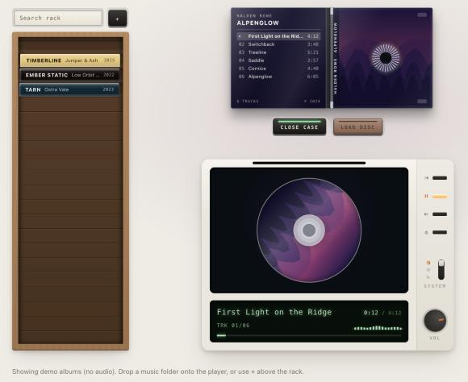

# CD case & player

A jewel-case CD player for your own music. Open the case, load the disc, press play. The disc label and accent colors are sampled from each cover, and the disc sheen and LCD meter follow the real audio through a Web Audio analyser.

No build step and no dependencies: plain ES modules plus a small Python server.



Your music never leaves your machine. The app makes no requests beyond your own server, has no analytics, and only reads your files.

## Run

Python 3 and nothing else to install:

```bash
git clone https://github.com/NathanBland/album-player.git
cd album-player
python3 scripts/serve.py
```

Then open http://localhost:5173. With nothing in `albums/` you get a few demo albums; see [Adding music](#adding-music) for your own.

Or run the published image (amd64 and arm64):

```bash
docker run -d --name album-player -p 5173:5173 -v /path/to/your/music:/music:ro ghcr.io/nathanbland/album-player:latest
```

The server exists because `python3 -m http.server` doesn't answer HTTP Range requests, which Safari needs to play audio and every browser needs to seek.

Options (flags or environment variables):

| Flag | Variable | Default | |
|---|---|---|---|
| `--host` | `HOST` | `127.0.0.1` | `0.0.0.0` to accept connections from other machines |
| `--port` | `PORT` | `5173` | |
| | `MUSIC_DIR` | `albums/` (`/music` in the Docker image) | your music collection, anywhere on disk (served at `/albums/`) |
| `--rescan` | `RESCAN_SECONDS` | `0` | `0`: rescan the library on every page load. `N`: scan once in the background, cache it, refresh every N seconds. `/albums/library.json?rescan=1` forces a rescan. |
| `--quiet` | `QUIET` | off | log only errors |

`/healthz` answers `ok` without touching the library. The server only serves the app and your music folder, and never lists directories. It has no authentication, so put it behind a reverse proxy with access control before exposing it beyond your network.

## Docker

The image is the app plus the same server (Python standard library only, no dependencies). The library is scanned in the background at startup and refreshed every 10 minutes.

**Mount your collection at `/music` inside the container.** In a volume mapping (`-v` or `volumes:`), the left side is where your music is on the host and the right side is where the container sees it. Change only the left side, and keep `:/music:ro`. If you mount it somewhere else, set `MUSIC_DIR` to that path; otherwise the scan finds nothing and the log reports `0 track(s)`.

To build it yourself instead of using `ghcr.io/nathanbland/album-player`:

```bash
docker build -t album-player .
```

```bash
docker run -d --name album-player -p 5173:5173 -v /path/to/your/music:/music:ro --restart unless-stopped album-player
```

Or with Compose: edit the music path in `docker-compose.yml`, then `docker compose up -d`.

**Verify the image.** `scripts/check-image.sh` builds it with Apple's [`container`](https://github.com/apple/container) (macOS 26 on Apple silicon) or Docker, whichever is installed, starts it with a throwaway music folder, and checks the app, the library scan, Range requests, the health check, no directory listings and the unprivileged user, then cleans up. `--multiarch` also builds linux/amd64, `--keep` keeps the image, and `--local` runs the same checks against `scripts/serve.py` with no image.

**Portainer.** Either create a stack from this Git repository (*Stacks → Add stack → Repository*, compose path `docker-compose.yml`), which builds the image on your host; or use the published image, which the included workflow (`.github/workflows/docker.yml`) builds for amd64 and arm64 on every push to `main`, and paste this into the web editor:

```yaml
services:
  album-player:
    image: ghcr.io/nathanbland/album-player:latest
    restart: unless-stopped
    ports: ["5173:5173"]
    volumes:
      - /path/to/your/music:/music:ro   # host path : container path (keep /music)
```

**Music on a NAS (NFS).** Use a named volume and mount it at `/music` the same way:

```yaml
services:
  album-player:
    image: ghcr.io/nathanbland/album-player:latest
    restart: unless-stopped
    ports: ["5173:5173"]
    volumes:
      - nas-music:/music:ro

volumes:
  nas-music:
    driver_opts:
      type: nfs
      o: "addr=192.168.1.10,nolock,soft,ro"
      device: ":/export/path/to/Music"
```

The container runs as uid 1000. When a scan finds nothing or skips folders, the log says why (nothing mounted at `/music`, a mount somewhere else, folders it isn't allowed to read and who owns them). If uid 1000 can't read your files, set `user: "<uid>:<gid>"` to match their owner rather than loosening permissions. The first page load after a start waits for the initial scan (a few seconds per thousand tracks; longer over a network share).

**Behind nginx (or any reverse proxy).** Every URL in the app is relative, so it works at the root or under a sub-path. Range requests must reach the container (nginx forwards them by default); turn off buffering so large files stream:

```nginx
location = /album-player { return 301 /album-player/; }
location /album-player/ {
    proxy_pass http://album-player:5173/;  # trailing slash strips the /album-player prefix
    proxy_http_version 1.1;
    proxy_set_header Host $host;
    proxy_buffering off;                   # stream audio instead of buffering whole files
    proxy_read_timeout 1h;
}
```

Serve it over HTTPS if you'll use it from other devices: plain-HTTP LAN addresses aren't a secure context, so browser features like Chrome's remembered-folder **Reconnect** are switched off there. Playback itself works either way.

## Adding music

**Library folder.** Put your music in `albums/` and reload. Any layout works (`Artist/Album`, `Artist - Album (Year)`, loose songs, `Disc 1`/`CD 02`/`Digital Media 01` subfolders), for example:

```
albums/
  Artist - Album Title (2024)/
    cover.jpg
    01 - First Song.mp3
    02 - Second Song.mp3
```

- **Albums come from tags, not folders.** ID3v2.2/2.3/2.4 and ID3v1 (mp3, and ID3 chunks in AIFF/WAV), Vorbis comments (FLAC), MP4 atoms (m4a) and RIFF INFO (wav) supply title, artist, album artist, album, year, genre, and track/disc numbers. Ogg/Opus tags aren't read yet.
  - Tracks with an album tag are grouped by album artist (or artist) and album, wherever they live: disc subfolders merge into one album, and a stray album track in an artist folder joins its album. A compilation without an album-artist tag becomes one "Various Artists" album as long as its tracks share a folder.
  - Tagged tracks without an album tag go into one **Singles** case per artist, with a generated cover.
  - Files with no usable tags at all are grouped by folder. Names come from the folder (`Artist - Title (Year)`, or `Artist/Album (Year)`), and track titles from file names with leading numbers and `Artist - Album - NN - ` prefixes stripped.
  - Tracks are ordered by disc and track number. Hidden files and macOS `._` AppleDouble files are ignored.
- Cover priority: an image named `cover`/`folder`/`front`/`album`/`art` or `AlbumArt_*_Large`, or the only full-size image in the folder (a `Disc N` folder also looks in its parent); then art embedded in the album's first tracks; then any other image. Thumbnails like `AlbumArtSmall.jpg` are a last resort. Without any, a placeholder is generated.
- Imports stream: each album is shelved as soon as its folder has been read, sliding into its sorted slot in the rack, so the first cases appear within seconds even for thousands of tracks. A plaque above the rack shows albums shelved, tracks read and an estimate of the time left, and the status line under the player logs the same. Tags are read a few files at a time, and embedded pictures are skipped except for the few tracks a cover is taken from.
- An optional `album.json` (`{"title": …, "artist": …, "year": …}`) in an album folder overrides both tags and parsed names.
- Formats: anything your browser plays natively (mp3, m4a/aac, flac, wav, ogg/opus, webm), plus AIFF/AIFF-C. If the browser can't decode a file, the player falls back to software decoding (see below). APE and single-file album rips with a `.cue` sheet aren't supported.

**Drop or pick.** Drag album folders (or a whole music folder) onto the player, or click **+** above the rack. The rack is remembered between visits (album names, covers and track paths in the browser's IndexedDB; no music is copied). Next time, click **Reconnect folder** (Chrome/Edge: one permission click) or **Choose folder** (Firefox/Safari: pick the same folder again) and the remembered albums link back up by path. Re-picking a folder you already have never duplicates albums; only new files are imported. **Forget** clears the remembered rack.

With an empty library the page shows four generated demo albums, which have no audio; their playback is simulated.

## Software decoding fallback

Some files won't play natively. For example, Chromium can't decode MPEG Layer II, which some stores ship as `.mp3`. When the browser reports an unsupported or undecodable file, the player identifies the codec from the file's first bytes and loads the matching [wasm-audio-decoders](https://github.com/eshaz/wasm-audio-decoders) build from `vendor/`. That build decodes the file in a Web Worker, and the result is played as WAV. Only the decoder that's needed is loaded.

| Codec | Decoder |
|---|---|
| MPEG Layer I/II/III | mpg123-decoder |
| FLAC, Ogg FLAC | @wasm-audio-decoders/flac |
| Ogg Vorbis | @wasm-audio-decoders/ogg-vorbis |
| Ogg Opus | ogg-opus-decoder |
| AIFF, AIFF-C | built in (byte swap to WAV, no WASM) |

After one track in an album fails natively, the rest of that album is decoded directly. The next track is decoded in the background while the current one plays. Up to three decoded tracks are kept in memory, at about 47 MB each for 4½ minutes of stereo. Versions and update instructions are in `vendor/README.txt`; to add a codec, see the `DECODERS` table in `js/decoders.js`.

## Controls

Space plays and pauses, ← goes to the previous track and → to the next. Media keys and the OS now-playing controls work through the Media Session API.

- **Seek:** click or drag the progress bar in the LCD, or focus it and use ←/→ for 5-second steps (Home/End jump to the start or end).
- **Volume:** drag the knob up or down, scroll on it, or focus it and use the arrow, Page Up/Down and Home/End keys. The setting is remembered per browser.
- **Track list:** with the case open, click a track on the liner notes to play from there.

## Static hosting

`python3 scripts/scan_library.py` writes `albums/library.json`, so the folder can be served by any static host. The host must support Range requests, which most do.

## Development

There's nothing to build: edit the files and reload. `scripts/check-image.sh --local` runs the server smoke tests without Docker. Add `?perf` to the URL for an overlay with frame timings, long tasks and audio stalls (it works on phones too, and **Copy log** copies everything for a bug report).

Issues and pull requests are welcome.

## License

[MIT](LICENSE). The decoders in `vendor/` are [wasm-audio-decoders](https://github.com/eshaz/wasm-audio-decoders) by Ethan Halsall, also MIT.
